# BITMAP_Starthilfe – Modulabhängigkeiten (analog Klassendiagramm)

Modul = "Klasse" (Kasten mit Stereotyp, Datei-/Modulnamen und öffentlichen Funktionen als Operationen).
Gepunktete Pfeile (`..>`) = UML-Dependency: Quelle inkludiert/nutzt Ziel (`#include` bzw. Funktionsaufruf).
Gepunktete Pfeile mit hohler Dreiecksspitze (`..|>`) = UML-Realisierung: Modul implementiert das Ziel-Interface.
Externe Pakete stehen als `ext:`-Zeile im jeweiligen Modulkasten; ihr Inhalt (Header) einmalig als Legende.

Datenbasis: `#include`-Relation der Projekt-Module aus `Src/main.c` und den vorgegebenen Modulen aus
`../BITMAP/Src` + `../BITMAP/Inc` (Stand: Branch `bitmap_transfer_usb`).
Gegenüber der Musterlösung `../BITMAP` fehlt die komplette BMP-Pipeline
(`bmpApp`, `colorTable`, `compressedBMP`, `uncompressedBMP`, `lineHandling`, `lineBuffer`,
`LCDbufferedOutput`, `bmp_config`) — das ist die Aufgabe der Studierenden.

Die Transportschicht (blau) ist als Dispatcher modelliert: `byte_io` ruft zur Laufzeit
entweder `byte_io_usb` oder `byte_io_uart` über das Interface `byte_io_backend`
(siehe `Src/byte_io.c` `byte_io_get()` – Dispatch auf `byte_io_uart_get()`/`byte_io_usb_get()`).

```mermaid
classDiagram
    %% ---------- Anwendung ----------
    class main {
        <<module>> Starthilfe (Rahmenprogramm)
        Src/main.c
        +main()
        ext: ITS_BRD_LIB, DisplayWaveshare
    }
    class fileHeader {
        <<module>> Einstiegsfunktion Input (gekapselt, vorgegeben)
        ../BITMAP/Src/fileHeader.c + ../BITMAP/Inc/fileHeader.h
        +input_file_header() int
        ext: ITS_BRD_LIB, DisplayWaveshare, STM32CubeF4
    }
    class input {
        <<module>> Protokoll-/Dateischicht (vorgegeben)
        ../BITMAP/Src/input.c + ../BITMAP/Inc/input.h
        +ask_transport() transport_t
        +show_s5_hint()
        +wait_for_s_i(btn)
        +init_input(transport_t)
        +open_nxt_file()
        +nxt_chr() int
        +read_file(buf,size,count) int
        +eof() bool
        ext: ITS_BRD_LIB, STM32CubeF4
    }
    class headers {
        <<module>> Header einlesen + pruefen (vorgegeben)
        ../BITMAP/Src/headers.c + ../BITMAP/Inc/headers.h
        +read_hdrs() int
        +get_file_hdr(p)
        +get_info_hdr(p)
    }

    %% ---------- Transportschicht ----------
    class byte_io {
        <<module>> Dispatcher
        ../BITMAP/Src/byte_io.c + ../BITMAP/Inc/byte_io.h
        +byte_io_init(transport_t)
        +byte_io_transport() transport_t
        +byte_io_get() uint8_t
        +byte_io_put(byte)
        +byte_io_clear()
    }
    class byte_io_backend {
        <<interface>>
        ../BITMAP/Inc/byte_io_backend.h
        +byte_io_usb_init()
        +byte_io_usb_get() uint8_t
        +byte_io_usb_put(b)
        +byte_io_usb_clear()
        +byte_io_uart_init()
        +byte_io_uart_get() uint8_t
        +byte_io_uart_put(b)
        +byte_io_uart_clear()
        ext: CMSIS/libc
    }
    class byte_io_usb {
        <<module>> USB-CDC-Backend
        ../BITMAP/Src/byte_io_usb.c
        +byte_io_usb_init()
        +byte_io_usb_get() uint8_t
        +byte_io_usb_put(b)
        +byte_io_usb_clear()
        ext: STM32CubeF4, ITS_BRD_LIB
    }
    class byte_io_uart {
        <<module>> UART-via-USB-Backend
        ../BITMAP/Src/byte_io_uart.c
        +byte_io_uart_init()
        +byte_io_uart_get() uint8_t
        +byte_io_uart_put(b)
        +byte_io_uart_clear()
        ext: STM32CubeF4
    }
    class transport {
        <<enumeration>> transport_t
        ../BITMAP/Inc/transport.h
        TRANSPORT_USB_CDC
        TRANSPORT_UART_VIA_USB
        ext: CMSIS/libc
    }
    class cdc_input_if {
        <<interface>> CDC-Hooks/-Wrapper
        ../BITMAP/Inc/cdc_input_if.h
        +cdc_collect(data,len)
        +usb_rx_arm_when_space()
        +cdc_rx_arm() bool
        +cdc_tx_busy() bool
        +cdc_transmit(buf,len) uint8_t
        ext: CMSIS/libc
    }
    class ringbuf {
        <<module>>
        ../BITMAP/Src/ringbuf.c + ../BITMAP/Inc/ringbuf.h
        +ringbuf_init()
        +ringbuf_write(data,len) uint32_t
        +ringbuf_available() uint32_t
        +ringbuf_free() uint32_t
        +ringbuf_get(out) bool
        +ringbuf_flush()
        ext: CMSIS/libc
    }

    %% ---------- USB-Device-Stack ----------
    class usb_device {
        <<module>>
        ../BITMAP/Src/usb_device.c + ../BITMAP/Inc/usb_device.h
        +usb_device_init()
        ext: STM32CubeF4, ITS_BRD_LIB
    }
    class usbd_cdc_if {
        <<module>> CDC-Anwendungsadapter
        ../BITMAP/Src/usbd_cdc_if.c + ../BITMAP/Inc/usbd_cdc_if.h
        +usbd_interface_fops_fs
        ext: STM32CubeF4
    }
    class usbd_conf {
        <<module>> HAL-Glue
        ../BITMAP/Src/usbd_conf.c + ../BITMAP/Inc/usbd_conf.h
        +USBD_static_malloc(size)
        +USBD_static_free(p)
        ext: STM32CubeF4
    }
    class usbd_desc {
        <<module>>
        ../BITMAP/Src/usbd_desc.c + ../BITMAP/Inc/usbd_desc.h
        USBD_DescriptorsTypeDef
        ext: STM32CubeF4
    }
    class usb_clock_config {
        <<module>>
        ../BITMAP/Src/usb_clock_config.c + ../BITMAP/Inc/usb_clock_config.h
        +switch_to_168_MHz()
        ext: STM32CubeF4, ITS_BRD_LIB
    }

    %% ---------- Infrastruktur / Typen ----------
    class errorhandler {
        <<module>>
        ../BITMAP/Src/errorhandler.c + ../BITMAP/Inc/errorhandler.h
        +my_err_handler(cnd,file,line,err,loop) int
        CHECK / CHECK_FATAL
        CHECK_OR_RETURN / RETURN_ON_ERROR
        ext: ITS_BRD_LIB
    }
    class BMP_types {
        <<datatype>>
        ../BITMAP/Inc/BMP_types.h
        BITMAPFILEHEADER / BITMAPINFOHEADER
        RGBQUAD / RGBTRIPLE
        BI_RGB, BI_RLE8, BMP_SIGNATURE
        ext: CMSIS/libc
    }
    class MS_basetypes {
        <<datatype>>
        ../BITMAP/Inc/MS_basetypes.h
        CHAR SHORT LONG DWORD BOOL BYTE WORD
        ext: CMSIS/libc
    }

    %% ---------- externe Pakete (Legende, ohne Kanten) ----------
    class EXT_ITS_BRD_LIB {
        <<external package>>
        lcd.h, timer.h, delay.h, init.h, error.h
    }
    class EXT_DisplayWaveshare {
        <<external package>>
        LCD_GUI.h, LCD_Touch.h, LCD_general.h, fontsFLASH.h
    }
    class EXT_STM32CubeF4 {
        <<external package>>
        stm32f4xx_hal*/ll_*, usbd_core/cdc/def/ctlreq, core_cm4.h
    }
    class EXT_CMSIS_libc {
        <<external package>>
        stdint.h, stdbool.h, stdio.h, stdlib.h
    }

    %% ---------- interne Abhängigkeiten (include/uses) ----------
    main ..> input
    main ..> fileHeader
    main ..> errorhandler
    main ..> usb_clock_config

    fileHeader ..> input
    fileHeader ..> headers
    fileHeader ..> errorhandler
    fileHeader ..> BMP_types

    input ..> byte_io
    input ..> errorhandler
    input ..> transport

    headers ..> input
    headers ..> errorhandler
    headers ..> BMP_types

    byte_io ..> byte_io_backend
    byte_io ..> transport

    byte_io_usb ..|> byte_io_backend
    byte_io_usb ..> cdc_input_if
    byte_io_usb ..> ringbuf
    byte_io_usb ..> usb_device
    byte_io_uart ..|> byte_io_backend

    usb_device ..> usbd_cdc_if
    usb_device ..> usbd_desc
    usbd_cdc_if ..> usb_device
    usbd_cdc_if ..> cdc_input_if
    usbd_desc ..> usbd_conf
    BMP_types ..> MS_basetypes
```



## Lesart der Transportschicht (Fokus `byte_io`)

```
input.c ──uses──> byte_io.h (nur blockierende Byte-Primitive)
                     │ byte_io.c: Dispatcher, wählt Backend zur Laufzeit
                     ├──dispatch──> byte_io_usb.c  ──> cdc_input_if / ringbuf / usb_device
                     └──dispatch──> byte_io_uart.c (USART3 + DMA1-Ringpuffer, LL-Driver)
                     beide implementieren das «interface» byte_io_backend.h
```

`transport.h` (`transport_t`) legt fest, welches Protokoll die PC-Anwendung fährt:
`TRANSPORT_USB_CDC` ('F' pro Datei, Flusskontrolle per USB-NAK) vs.
`TRANSPORT_UART_VIA_USB` ('S' pro Datei, Burst-Request per 'D').

Gerenderte Grafik: `ModulAbhaengigkeiten.svg` (gleiche Daten, als SVG mit UML-Notation:
Modul-Kästen mit Datei-/Modulnamen und `ext:`-Zeilen; die externen Pakete stehen nur einmal
als Legende in der Fußzeile. Die reinen Blatt-Module `errorhandler`, `transport`,
`MS_basetypes` und `ringbuf` sind ganz nach unten in eine eigene Schicht gepinnt; im SVG
als Sammelleitung (Bus) gezeichnet: viele Nutzer docken ohne Pfeil an eine Leitung an,
ein einzelner Pfeil geht ins Blatt-Modul.)
